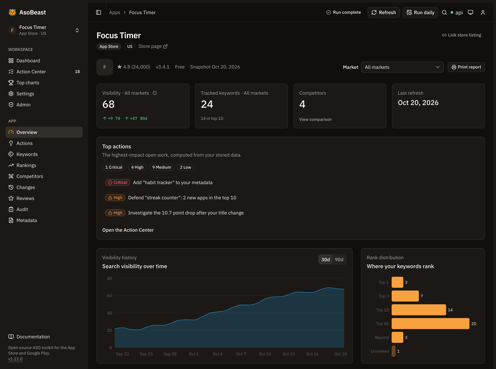

<div align="center">
  <a href="https://asobeast.com"></a>
  <h1>AsoBeast</h1>
  <p><strong><a href="https://asobeast.com">AsoBeast</a> is an open source App Store Optimization (ASO) tool and keyword rank tracker for the Apple App Store and Google Play.</strong></p>
  <p>Use the hosted service at <a href="https://asobeast.com">asobeast.com</a>, or self-host the open source edition on your own server.</p>
  <p>
    <a href="LICENSE"></a>
    <a href="https://github.com/AsoBeast/asobeast/releases"></a>
    <a href="https://github.com/AsoBeast/asobeast/actions/workflows/ci.yml"></a>
    <a href="https://github.com/AsoBeast/asobeast/commits/main"></a>
    <a href="https://github.com/AsoBeast/asobeast/stargazers"></a>
    <a href="https://docs.asobeast.com"></a>
  </p>
  <p>
    <a href="https://asobeast.com"><strong>Website</strong></a> ·
    <a href="https://docs.asobeast.com/quickstart"><strong>Quickstart</strong></a> ·
    <a href="https://docs.asobeast.com/install/docker-compose"><strong>Self-host</strong></a> ·
    <a href="https://docs.asobeast.com/mcp/introduction"><strong>MCP server</strong></a> ·
    <a href="https://docs.asobeast.com/api-reference/introduction"><strong>API</strong></a> ·
    <a href="https://docs.asobeast.com/support"><strong>Support</strong></a> ·
    <a href="CHANGELOG.md"><strong>Changelog</strong></a>
  </p>
</div>

<a href="https://docs.asobeast.com/quickstart"></a>

## What is AsoBeast?

AsoBeast is an App Store Optimization (ASO) tool and keyword rank tracker for the Apple App Store and Google Play. It imports a listing, tracks keyword rankings daily to a depth of 200, watches competitors, reviews and metadata, and turns that history into a prioritized queue of ASO work. This repository is the free, open source edition that you run on your own server, and the hosted service at [asobeast.com](https://asobeast.com) runs the same code.

Every store request runs on the machine hosting AsoBeast as an ordinary public search or page request, so Apple and Google see each tracked phrase the way they see any search. You sign up with no ASO vendor, buy no API key, and share your keyword list with nobody. Beyond those store requests, your data stays in your deployment unless you explicitly enable an outbound integration such as webhook alerts, email, OpenAI assistance, Apple Ads search popularity or store status updates.

## Who is AsoBeast for?

AsoBeast is built for people who ship apps and want their ASO data to stay theirs: indie developers, small studios and agencies tracking a handful of apps across several storefronts. It fits if you want ASO tracking without a per keyword subscription, need the data on your own infrastructure, or want to query your ASO history from an agent or a script instead of a dashboard. It collects from the public store endpoints at a deliberately modest rate, so it suits a portfolio measured in apps rather than hundreds. See [who AsoBeast is for](https://docs.asobeast.com/#who-is-asobeast-for).

## Why AsoBeast?

- **No accounts, no vendor API keys.** AsoBeast collects from the public store endpoints at a deliberately modest rate. You need Docker and nothing else.
- **Your keyword list stays yours.** It lives in your database and is never sent to an ASO vendor, so no competitor intelligence product assembles it from your searches. The stores only ever see one search at a time.
- **Both stores as one tracking entity.** One app row tracks keywords across many storefronts, so `us` and `de` are markets on the same listing rather than two subscriptions.
- **Every score shows its evidence.** Popularity and difficulty carry their source, calculation version, capture date and confidence, so you can argue with a number instead of trusting it.
- **Deterministic recommendations.** Seventeen rules turn stored history into an explainable work queue. AI is optional garnish that can summarize an action, never invent or reorder one.
- **AGPL-3.0, no open core.** Every feature the hosted service runs is in this repository.

## Features

| Feature                          | What it does                                                                                                                                                                                                                      |
| -------------------------------- | --------------------------------------------------------------------------------------------------------------------------------------------------------------------------------------------------------------------------------- |
| Two live stores                  | Import an Apple App Store or Google Play URL, snapshot the metadata, refresh on demand and diff every field                                                                                                                       |
| Keyword tracking                 | Track any validated storefront, see daily positions and history, bulk edit, and keep the private 100 character iOS keyword field by hand                                                                                          |
| Market suggestions               | Reads the languages your listing ships and suggests the storefronts that read them, with the daily request cost, then seeds a chosen market with the keywords of its own listing                                                  |
| Rank checks to depth 200         | One search per keyword and market serves your app and all of its competitors, so competitor tracking costs no extra requests                                                                                                      |
| Transparent scoring              | Popularity and difficulty with provenance and confidence, plus opportunity derived on read                                                                                                                                        |
| SERP and category intelligence   | Retained SERP snapshots, volatility, entrants and movers, and top charts by country and category with movement, trending apps and chart follows                                                                                   |
| Competitor discovery             | Find competitors from live search results, compare listings and find keyword gaps                                                                                                                                                 |
| Reviews and change detection     | Sync reviews and rating history, draft and track replies to them, mine review language for keyword ideas, and detect owned and competitor metadata changes                                                                        |
| Store funnel                     | Optionally connect an App Store Connect key and see impressions, product page views, Get taps and conversion by market beside your rankings and every listing change, with history back to 2024                                   |
| ASO audit and metadata workbench | A deterministic audit rubric with history, store metadata lints and strategic keyword buckets                                                                                                                                     |
| ASO Action Center                | Seventeen deterministic rules produce recommendations with a priority, an estimated impact, the evidence behind them, a deep link, a full lifecycle and a verified outcome                                                        |
| Portfolio analysis               | Group linked listings across stores and countries, compare group visibility and generate weekly digests                                                                                                                           |
| Alerts                           | Signed webhooks or SMTP email for rank, SERP, metadata, review and new action events, with resumable batched delivery                                                                                                             |
| MCP server                       | 37 read tools, plus 7 opt-in tools that change keywords, competitors, actions and annotations, over stdio or a remote endpoint, so Claude Code, Claude Desktop, Cursor, VS Code and other MCP clients can work with your instance |

A guide for each of these lives in the [documentation](https://docs.asobeast.com).

## Quick start

### One-click deploy

[](https://railway.com/deploy/asobeast?referralCode=GAJ6fQ&utm_medium=integration&utm_source=template&utm_campaign=asobeast-readme)

Runs the published images on Railway with PostgreSQL and Redis, and generates every secret for you. See [deploy on Railway](https://docs.asobeast.com/install/railway).

### Docker Compose

You need [Docker](https://docs.docker.com/get-docker/) with Compose, roughly 2 GB of memory and 5 GB of disk.

```bash
git clone https://github.com/AsoBeast/asobeast.git
cd asobeast
printf 'POSTGRES_PASSWORD=%s\nAUTH_SECRET=%s\n' "$(openssl rand -hex 32)" "$(openssl rand -hex 32)" > .env
chmod 600 .env
docker compose up --build -d --wait
```

Open http://localhost:3001 and create the owner account. Registration closes automatically once it exists. Safari does not keep the session cookie over plain HTTP, so use Chrome or Firefox for a local evaluation, or see [signing in returns to the sign in form](https://docs.asobeast.com/operations/troubleshooting#signing-in-returns-to-the-sign-in-form). Import a store URL and keyword tracking starts immediately.

Prefer published images to a build? `docker-compose.pull.yml` runs the same stack from GHCR without a clone:

```bash
curl -fsSLO https://raw.githubusercontent.com/AsoBeast/asobeast/main/docker-compose.pull.yml
printf 'POSTGRES_PASSWORD=%s\nAUTH_SECRET=%s\n' "$(openssl rand -hex 32)" "$(openssl rand -hex 32)" > .env
chmod 600 .env
docker compose -f docker-compose.pull.yml up -d --wait
```

Full walkthrough: [quickstart](https://docs.asobeast.com/quickstart). Image tags, pinning and upgrades: [run a published release](https://docs.asobeast.com/install/published-images).

### Connect an AI agent

Every instance serves a Model Context Protocol endpoint. Create a personal API token on the settings page, then point Claude Code at it:

```bash
claude mcp add --transport http asobeast https://your-host/api/backend/mcp --header "Authorization: Bearer asob_…"
```

Ask it which keywords dropped this week, which competitor entered the top 10 or what the Action Center wants done first. Configuration for Claude Desktop, Cursor, VS Code, Gemini CLI, Windsurf and the local stdio server is in [set up the MCP server](https://docs.asobeast.com/mcp/setup), and [MCP recipes](https://docs.asobeast.com/mcp/recipes) has prompts to start from.

## How AsoBeast compares

|                            | AsoBeast (self-hosted)            | Subscription ASO platforms       |
| -------------------------- | --------------------------------- | -------------------------------- |
| Where store requests run   | Your machine                      | Their infrastructure             |
| Who sees your keyword list | You                               | The vendor                       |
| Cost model                 | Your hosting bill                 | Per seat, per app or per keyword |
| Keyword history            | Yours, retained on your terms     | Ends when the subscription does  |
| Score methodology          | Published, versioned, inspectable | Usually proprietary              |
| Extending it               | Fork it, it is AGPL-3.0           | File a feature request           |

A hosted AsoBeast is a separate product built from this same repository. Self-hosted installations get every feature.

## Tech stack

pnpm and Turborepo, TypeScript strict throughout, NestJS, Prisma, PostgreSQL 18, BullMQ, Redis 8, Next.js with Tailwind, Docker Compose.

Contributor setup, architecture and the module map: [local development](https://docs.asobeast.com/install/local-development) and [how AsoBeast works](https://docs.asobeast.com/concepts/architecture).

## Configuration

Every environment variable, with defaults and what each one changes, is documented in the [configuration reference](https://docs.asobeast.com/configuration/reference). `apps/api/.env.example` and `apps/web/.env.example` are the authoritative lists in the repository.

A default installation needs two variables, `POSTGRES_PASSWORD` and `AUTH_SECRET`. Everything else has a working default.

## FAQ

### What is App Store Optimization?

App Store Optimization is the practice of improving how an app ranks and converts in App Store and Google Play search. It covers keyword targeting in indexed metadata fields, competitor positioning, ratings and reviews, and category performance.

### Does AsoBeast need an App Store Connect or Google Play Console account?

No. AsoBeast reads public store data, so you can track any app including your competitors, and it never needs an ASO vendor API key. Connecting an App Store Connect key is optional: it adds Apple's own impressions and conversion for your apps, and the key is sealed at rest. See [the store funnel](https://docs.asobeast.com/guides/store-funnel).

### Which app stores does AsoBeast support?

Both the Apple App Store and Google Play. Apple indexes a title, a subtitle and a private 100 character keyword field. Google Play indexes a title, an 80 character short description and a long description, so subtitle and keyword field stay Apple only concepts. See [stores](https://docs.asobeast.com/concepts/stores).

### How often does it check rankings?

Once a day by default, on a UTC cron you control. Rank checks capture position to a depth of 200, and a position of `null` means checked and not found within that depth rather than zero. See [positions](https://docs.asobeast.com/concepts/positions).

### Can I track more than one country?

Yes. An app is imported once, and keyword tracking carries its own storefront, so one listing can track keywords in many markets at once. Each added market multiplies daily store requests, and the settings page shows a budget card that estimates the fan-out. See [countries and markets](https://docs.asobeast.com/concepts/countries).

### Is any of my data sent anywhere?

Only the store requests themselves, which send each tracked phrase to the App Store or Google Play as an ordinary search, from your own address or through a proxy provider if you configure one. Beyond those, webhook alerts, SMTP email, OpenAI assistance, Apple Ads search popularity and the store status poll are the only outbound integrations, and each is off until configured. There is no telemetry. See [what leaves your deployment](https://docs.asobeast.com/legal/data-collection).

### Can I connect AsoBeast to Claude or another AI agent?

Yes. AsoBeast ships a Model Context Protocol server with 37 read tools, available as a local stdio process or as a remote endpoint on your instance. Every connection needs a personal API token and reads by default. Seven more tools that change keywords, competitors, actions and annotations are listed only to a token you give the write scope. See [MCP](https://docs.asobeast.com/mcp/introduction).

### Is AsoBeast really free?

The software is, entirely. It is AGPL-3.0 with no open core and no feature held back for a commercial edition, so a self-hosted installation has everything. A hosted service built from this same repository is charged for the hosting it uses, never for features. If you run a modified version as a network service, the AGPL asks you to offer that modified source to its users.

## Documentation

| Topic                                   | Link                                                                                                        |
| --------------------------------------- | ----------------------------------------------------------------------------------------------------------- |
| Quickstart and first import             | [docs.asobeast.com/quickstart](https://docs.asobeast.com/quickstart)                                        |
| Self-hosting with Docker Compose        | [install/docker-compose](https://docs.asobeast.com/install/docker-compose)                                  |
| Configuration reference                 | [configuration/reference](https://docs.asobeast.com/configuration/reference)                                |
| Concepts: scoring, positions, countries | [concepts](https://docs.asobeast.com/concepts/architecture)                                                 |
| Guides: keywords, competitors, alerts   | [guides](https://docs.asobeast.com/guides/track-keywords)                                                   |
| Operations: backups, restore, upgrades  | [operations](https://docs.asobeast.com/operations/backups)                                                  |
| Troubleshooting and support             | [support](https://docs.asobeast.com/support)                                                                |
| API reference and OpenAPI               | [api-reference](https://docs.asobeast.com/api-reference/introduction)                                       |
| MCP tools                               | [mcp/tools](https://docs.asobeast.com/mcp/tools)                                                            |
| The whole site for an LLM               | [llms.txt](https://docs.asobeast.com/llms.txt) and [llms-full.txt](https://docs.asobeast.com/llms-full.txt) |

## Limitations

Worth knowing before you rely on it:

- **Scores are store-specific estimates.** Popularity and difficulty come from different public evidence on each store, so the numbers are not comparable across stores and are not a substitute for first-party acquisition data.
- **Scrapers can break.** AsoBeast reads public endpoints. When a store changes one, a parser can fail. Failures fail the job, which BullMQ retries with backoff, and never take down request handling.
- **Store rate limits cap capacity before hardware does.** The public endpoints tolerate only modest request rates per address, which is what limits how many keyword markets one instance can track. See [capacity and limits](https://docs.asobeast.com/operations/capacity).
- **Operations are yours.** Backups, TLS, secret rotation, monitoring and upgrades are the operator's responsibility. Verify a restore before you rely on a backup.

## Roadmap

The `1.x` line is current, and the [changelog](CHANGELOG.md) names the latest release. What remains open:

- A per-user permission model finer than owner and member, and one account in several workspaces.
- Better popularity calibration using licensed or first-party acquisition data.
- Per-market reviews, category ranks and ratings history. Listings and their screenshot captions are already captured and switched per market.
- More MCP write tools behind the same opt-in, one reversible change at a time.

Release policy and the `1.x` compatibility promise: [upgrade and roll back](https://docs.asobeast.com/install/upgrade).

## Contributing

Pull requests are welcome. Read [CONTRIBUTING.md](CONTRIBUTING.md) first for the commit conventions, the compatibility promise and how the test suites are run. Bugs, questions and feature requests go to [GitHub issues](https://github.com/AsoBeast/asobeast/issues). Security reports go through [SECURITY.md](SECURITY.md), never a public issue.

<a href="https://github.com/AsoBeast/asobeast/graphs/contributors"></a>

## License

This repository's source code is available under the [AGPL-3.0 license](LICENSE).
