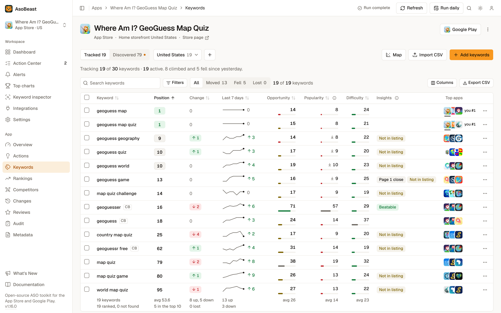

<div align="center">
  <a href="https://asobeast.com/?utm_source=github&utm_medium=readme&utm_campaign=asobeast-readme"></a>
  <h1>AsoBeast</h1>
  <p><strong>AsoBeast is an open-source App Store Optimization (ASO) tool and keyword rank tracker for the Apple App Store and Google Play.</strong></p>
  <p>See where your app ranks for every tracked keyword each day, and what to change next.</p>
  <p>Use the hosted service at <a href="https://asobeast.com/?utm_source=github&utm_medium=readme&utm_campaign=asobeast-readme">asobeast.com</a>, or self-host it free with Docker under AGPL-3.0. Both run the same code.</p>
  <p>
    <a href="https://app.asobeast.com/register?utm_source=github&utm_medium=readme&utm_campaign=hero"></a>
    <a href="#quick-start"></a>
  </p>
  <p>
    <a href="LICENSE"></a>
    <a href="https://github.com/AsoBeast/asobeast/releases"></a>
    <a href="https://github.com/AsoBeast/asobeast/stargazers"></a>
  </p>
  <p>
    <a href="https://docs.asobeast.com">Docs</a> ·
    <a href="https://docs.asobeast.com/mcp/introduction">MCP server</a> ·
    <a href="https://docs.asobeast.com/api-reference/introduction">API</a> ·
    <a href="https://github.com/AsoBeast/asobeast/releases">Releases</a> ·
    <a href="https://docs.asobeast.com/support">Support</a>
  </p>
</div>

<a href="https://asobeast.com/?utm_source=github&utm_medium=readme&utm_campaign=asobeast-readme"></a>

## What is AsoBeast?

**AsoBeast** is a self-hostable ASO tool for App Store and Google Play keyword research and daily rank tracking. It imports a listing, tracks its keyword rankings every day, watches competitors, reviews and listing changes, and turns that history into a prioritized list of ASO work. It is an open-source alternative to AppTweak and AppFollow for keyword research and rank tracking, built for indie developers, small studios and agencies with a portfolio measured in apps rather than hundreds.

A self-hosted AsoBeast sends every store request as an ordinary public search or page request from your own server. You need no ASO vendor account or API key, your keyword list stays in your own database, and there is no telemetry.

## Quick start

Start a [free 7-day trial at asobeast.com](https://app.asobeast.com/register?utm_source=github&utm_medium=readme&utm_campaign=quick-start) if you would rather not run a server. To self-host, deploy on Railway in one click, or run Docker Compose on any machine with about 2.5 GB of memory and 5 GB of disk.

[](https://railway.com/deploy/asobeast?referralCode=GAJ6fQ&utm_medium=integration&utm_source=template&utm_campaign=asobeast-readme)

The [Railway template](https://docs.asobeast.com/install/railway) runs the published images with PostgreSQL and Redis and generates every secret.

To run the published images with [Docker](https://docs.docker.com/get-docker/) Compose instead:

```bash
curl -fsSLO https://raw.githubusercontent.com/AsoBeast/asobeast/main/docker-compose.pull.yml
printf 'POSTGRES_PASSWORD=%s\nAUTH_SECRET=%s\n' "$(openssl rand -hex 32)" "$(openssl rand -hex 32)" > .env
chmod 600 .env
docker compose -f docker-compose.pull.yml up -d --wait
```

Open http://localhost:3001, create the owner account (registration then closes) and import a store URL. AsoBeast picks keywords from the listing and runs their first rank checks right away.

> [!NOTE]
> Safari drops the session cookie on plain HTTP, so use Chrome or Firefox for a local evaluation or put the instance behind HTTPS. See [troubleshooting](https://docs.asobeast.com/operations/troubleshooting#signing-in-returns-to-the-sign-in-form).

<details>
<summary>Build from source instead</summary>

```bash
git clone https://github.com/AsoBeast/asobeast.git
cd asobeast
printf 'POSTGRES_PASSWORD=%s\nAUTH_SECRET=%s\n' "$(openssl rand -hex 32)" "$(openssl rand -hex 32)" > .env
chmod 600 .env
docker compose up --build -d --wait
```

</details>

A default AsoBeast installation needs only `POSTGRES_PASSWORD` and `AUTH_SECRET`. The [configuration reference](https://docs.asobeast.com/configuration/reference) lists every other option, and [run a published release](https://docs.asobeast.com/install/published-images) covers image tags and pinning.

If AsoBeast works for you, a star on this repository helps other app developers find it.

### Connect an AI agent over MCP

Create a personal API token on the Integrations page, then add your instance to Claude Code:

```bash
claude mcp add --transport http asobeast https://your-host/api/backend/mcp --header "Authorization: Bearer asob_…"
```

Ask the agent which keywords dropped this week, which competitor entered the top 10 or which action the Action Center ranks first. [Set up the MCP server](https://docs.asobeast.com/mcp/setup) covers Claude Desktop, Cursor, VS Code, Gemini CLI, Windsurf and the local stdio server, and [MCP recipes](https://docs.asobeast.com/mcp/recipes) has prompts to start from.

## Features

<a href="https://docs.asobeast.com/guides/track-keywords"></a>

- Import any App Store or Google Play URL once and [track its keywords](https://docs.asobeast.com/guides/track-keywords) daily in as many countries as you need. Setup suggests markets from the languages your listing ships.
- [Rank checks](https://docs.asobeast.com/concepts/positions) read as deep as each store lists, up to 200: the App Store usually returns 140 to 200 results and Google Play about 30. One search per keyword covers your app and every competitor.
- Research any keyword before you track it: the [keyword inspector](https://docs.asobeast.com/guides/keyword-inspections) shows popularity, difficulty, the store's autocomplete and the top 50 apps in any country, and [keyword discovery](https://docs.asobeast.com/guides/keyword-discovery) finds the searches your app already ranks for.
- AsoBeast scores every keyword for popularity, difficulty and opportunity, and each score shows its source, calculation version, capture date and confidence. Popularity estimates a keyword's search demand, and difficulty estimates how hard its current top results are to displace. The [scoring method](https://docs.asobeast.com/concepts/scoring) is published and versioned.
- [Competitors](https://docs.asobeast.com/guides/competitors) come from live search results, with the keyword gaps where each one outranks you, and you can follow [top charts](https://docs.asobeast.com/guides/top-charts) by country and category.
- The [metadata workbench](https://docs.asobeast.com/guides/metadata-workbench) lints each indexed field against its store limit and holds one private iOS keyword field per localization.
- Link the App Store and Google Play listings of one product into a [portfolio](https://docs.asobeast.com/guides/portfolio) group, and send its weekly digest to an alert channel.
- Every metadata change, yours or a competitor's, lands in the [changes feed](https://docs.asobeast.com/guides/listing-changes). Your own changes show what they did to positions and visibility after 7, 14 and 28 days.
- [Reviews](https://docs.asobeast.com/guides/reviews) sync with their ratings, and repeated language in negative reviews becomes keyword ideas. You can draft a reply with AI and, with the store console connected, post it once you approve it.
- The [Action Center](https://docs.asobeast.com/guides/action-center) runs seventeen deterministic rules over your history and ranks what to do next, each action with the numbers behind it. AI can summarize an action but never adds or reorders one. The [audit](https://docs.asobeast.com/guides/aso-audit) scores the listing itself.
- Connect an App Store Connect key or a Google Play service account to read the [store's own reports](https://docs.asobeast.com/guides/store-funnel): impressions, page views, Get taps and conversion on the App Store, and installs per search term on Google Play.
- [Alerts](https://docs.asobeast.com/guides/alerts) for rank drops, first rankings, metadata changes, chart moves, rating drops and review spikes go out by email, webhook, Slack, Discord, Microsoft Teams, Telegram or Google Chat.
- The [MCP server](https://docs.asobeast.com/mcp/introduction) gives Claude, Cursor, VS Code and other clients 42 read tools and 8 opt-in write tools, and the [HTTP API](https://docs.asobeast.com/api-reference/introduction) is documented with OpenAPI.

## What's new in AsoBeast 2

AsoBeast 2 redesigns every screen. The dashboard and each app's overview open with what moved and what to do next, and the keywords page shows a trend line and the top apps for every keyword. AsoBeast 2 also adds the keyword inspector, featuring readiness in the audit and a ratings goal, and the changes feed now records in-app events and featuring.

Upgrading from AsoBeast 1.x needs no script or agent changes, because nothing in the HTTP API or the MCP tools was removed, renamed or narrowed, and the API migrates the database on boot. If you pin the image tag `1`, change it to `2`, because a major tag never moves to the next major. See [upgrade and roll back](https://docs.asobeast.com/install/upgrade).

## How AsoBeast compares

|                            | AsoBeast (self-hosted)            | Subscription ASO platforms         |
| -------------------------- | --------------------------------- | ---------------------------------- |
| Where store requests run   | Your machine                      | Their infrastructure               |
| Who sees your keyword list | You                               | The vendor                         |
| Cost model                 | Your hosting bill                 | Per seat, per app or per keyword   |
| Keyword history            | Yours, retained on your terms     | Usually ends with the subscription |
| Score methodology          | Published, versioned, inspectable | Usually proprietary                |
| Extending it               | Fork it, it is AGPL-3.0           | File a feature request             |

AsoBeast has no open core: the hosted service at asobeast.com runs the same code with every feature, so you can start on the [7-day free trial](https://app.asobeast.com/register?utm_source=github&utm_medium=readme&utm_campaign=compare) without running a server.

## Frequently asked questions

### Is AsoBeast free and open source?

AsoBeast is free and open source under AGPL-3.0. The hosted service at asobeast.com is paid, from \$10 a month, after a 7-day free trial on a card. Cancel before day 7 and nothing is charged. See [pricing](https://docs.asobeast.com/legal/pricing). If you offer a modified version as a network service, the AGPL asks you to share that modified source with its users.

### What is App Store Optimization (ASO)?

App Store Optimization (ASO) is the practice of improving how an app listing ranks and converts in App Store and Google Play search and charts.

### How do I track App Store and Google Play keyword rankings?

Import the app's store URL into AsoBeast. It picks keywords from the listing, runs their first rank checks right away, then checks every tracked keyword once a day in each country you add. See [track keywords](https://docs.asobeast.com/guides/track-keywords).

### Is AsoBeast an alternative to AppTweak or AppFollow?

For keyword research and daily rank tracking, yes. AsoBeast tracks App Store and Google Play rankings per country, scores keywords with a published method and imports keyword lists exported from AppFollow, Astro and Sonar. AsoBeast does not replace a large commercial ASO suite: it has no download or revenue estimates, and it checks the stores at a modest rate.

### Does AsoBeast need an App Store Connect or Google Play Console account?

No. AsoBeast reads public store data, so you can track any app, including your competitors. Connecting a console is optional and adds the store's own impressions, page views and conversion for your apps, and installs per search term on Google Play. The key is sealed at rest. See [the store funnel](https://docs.asobeast.com/guides/store-funnel).

### How often does AsoBeast check keyword rankings?

AsoBeast checks every tracked keyword once a day, by default at 03:00 UTC, on a schedule you can change. A position of `null` means the app was checked and not found within the depth checked, up to 200. See [positions](https://docs.asobeast.com/concepts/positions).

### Which app stores does AsoBeast support?

AsoBeast supports the Apple App Store and Google Play. Apple indexes the title, the subtitle and a private 100-character keyword field. Google Play indexes the title, an 80-character short description and the long description. See [stores](https://docs.asobeast.com/concepts/stores).

### Can I track keywords in more than one country?

Yes. An app is imported once and each tracked keyword carries its own country, so one listing can track many markets. Each market adds daily store requests, and setup shows what a market costs before you add it. See [countries and markets](https://docs.asobeast.com/concepts/countries).

### Can I connect AsoBeast to Claude or another AI agent?

Yes. Every AsoBeast instance serves a Model Context Protocol (MCP) endpoint. Each connection needs a personal API token and only reads by default. The tools that change data are listed only to a token you give the write scope. See [MCP tools](https://docs.asobeast.com/mcp/tools).

### Can I import keywords from another ASO tool?

Yes. The keyword import reads CSV exports from Astro, AppFollow and Sonar by their column headers, or any file with a keyword column. Positions and scores in the file are not imported, because AsoBeast measures them itself, so rank history starts on the day you import. See [files from other tools](https://docs.asobeast.com/guides/track-keywords#files-from-other-tools).

### Does AsoBeast send my data anywhere?

By default, a self-hosted AsoBeast sends only store requests from your server: public searches and listing pages, from your own address or through a proxy you configure. Everything else is off until you set it up: alerts, email, OpenAI assistance, Apple Ads popularity, the store status check and a connected App Store Connect or Google Play Console account. There is no telemetry. See [what leaves your deployment](https://docs.asobeast.com/legal/data-collection).

## Limitations

- AsoBeast scores are store-specific estimates built from public evidence. They are not comparable across stores and do not replace first-party download data.
- AsoBeast reads public store endpoints, and a store can change one without notice. When a parser breaks, its job fails and is retried with backoff. Request handling is not affected.
- Store rate limits, not hardware, cap how many keyword markets one instance can track. See [capacity and limits](https://docs.asobeast.com/operations/capacity).
- On a self-hosted instance, backups, TLS, monitoring and upgrades are yours to run.

## Documentation

[Quickstart](https://docs.asobeast.com/quickstart) · [Self-host with Docker Compose](https://docs.asobeast.com/install/docker-compose) · [How AsoBeast works](https://docs.asobeast.com/concepts/architecture) · [Feature guides](https://docs.asobeast.com/guides/track-keywords) · [Backups, restore and upgrades](https://docs.asobeast.com/operations/backups) · [API reference](https://docs.asobeast.com/api-reference/introduction) · [MCP tools](https://docs.asobeast.com/mcp/tools) · [Support](https://docs.asobeast.com/support)

For language models, the whole site is available as [llms.txt](https://docs.asobeast.com/llms.txt) and [llms-full.txt](https://docs.asobeast.com/llms-full.txt).

## Contributing

Pull requests are welcome. Read [CONTRIBUTING.md](CONTRIBUTING.md) first for the commit conventions, the compatibility promise and how to run the tests. Report bugs in [GitHub issues](https://github.com/AsoBeast/asobeast/issues), bring questions and ideas to [GitHub Discussions](https://github.com/AsoBeast/asobeast/discussions), and send security reports through [SECURITY.md](SECURITY.md), never a public issue.

AsoBeast is a TypeScript monorepo: NestJS, Prisma, PostgreSQL, BullMQ and Redis on the API side, Next.js and Tailwind on the web side. [Local development](https://docs.asobeast.com/install/local-development) and [how AsoBeast works](https://docs.asobeast.com/concepts/architecture) explain the setup and the architecture.

<a href="https://github.com/AsoBeast/asobeast/graphs/contributors"></a>

## License

AsoBeast is licensed under [AGPL-3.0-only](LICENSE). The license grants no trademark rights. [TRADEMARKS.md](TRADEMARKS.md) explains how the AsoBeast name and logo may be used. AppTweak, AppFollow, Astro and Sonar are trademarks of their owners and are named only to describe compatibility and alternatives.
