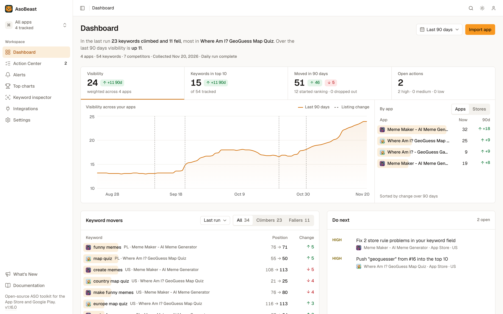

<div align="center">
  <a href="https://asobeast.com"></a>
  <h1>AsoBeast</h1>
  <p><strong>AsoBeast is an open-source App Store Optimization (ASO) tool and keyword rank tracker for the Apple App Store and Google Play.</strong></p>
  <p>Self-host it with Docker under AGPL-3.0, or use the hosted service at <a href="https://asobeast.com">asobeast.com</a>, which runs the same code.</p>
  <p>
    <a href="LICENSE"></a>
    <a href="https://github.com/AsoBeast/asobeast/releases"></a>
    <a href="https://github.com/AsoBeast/asobeast/actions/workflows/ci.yml"></a>
    <a href="https://github.com/AsoBeast/asobeast/stargazers"></a>
  </p>
  <p>
    <a href="https://asobeast.com"><strong>Website</strong></a> ·
    <a href="https://docs.asobeast.com"><strong>Docs</strong></a> ·
    <a href="https://docs.asobeast.com/quickstart"><strong>Quickstart</strong></a> ·
    <a href="https://docs.asobeast.com/mcp/introduction"><strong>MCP server</strong></a> ·
    <a href="https://docs.asobeast.com/api-reference/introduction"><strong>API</strong></a> ·
    <a href="https://github.com/AsoBeast/asobeast/releases"><strong>Releases</strong></a>
  </p>
</div>

<a href="https://asobeast.com"></a>

## What is AsoBeast?

AsoBeast is a self-hostable ASO tool and keyword rank tracker. It imports an App Store or Google Play listing, tracks its keyword rankings every day, watches competitors, reviews and listing changes, and turns that history into a prioritized list of ASO work. It checks the stores at a modest rate, so it suits indie developers, small studios and agencies with a portfolio measured in apps rather than hundreds.

Every store request is an ordinary public search or page request sent from the machine that runs AsoBeast. You need no ASO vendor account or API key, and your keyword list stays in your own database.

<a href="https://docs.asobeast.com/guides/track-keywords"></a>

## What's new in AsoBeast 2

Version 2 redesigns every screen. The dashboard and each app's overview now open with what moved and what to do next, and the keywords page shows a trend line and the top apps for every keyword. It adds the keyword inspector, featuring readiness in the audit and a ratings goal, and the changes feed now records in-app events and featuring.

Nothing in the HTTP API or the MCP tools was removed, renamed or narrowed, so scripts and agents built on 1.x keep working, and the API migrates the database on boot. If you pin the major image tag `1`, change it to `2`, because a major tag never moves to the next major. See [upgrade and roll back](https://docs.asobeast.com/install/upgrade).

## Features

- Import any App Store or Google Play URL once and [track its keywords](https://docs.asobeast.com/guides/track-keywords) daily in as many countries as you need. Setup suggests markets from the languages your listing ships.
- [Rank checks](https://docs.asobeast.com/concepts/positions) read as deep as each store lists, up to 200. The App Store usually answers 140 to 200 results and Google Play about 30, and one search per keyword covers your app and every competitor.
- [Inspect any keyword](https://docs.asobeast.com/guides/keyword-inspections) in any country before you track it, and [discover the searches](https://docs.asobeast.com/guides/keyword-discovery) your app already ranks for.
- Popularity, difficulty and opportunity each show their source, calculation version, capture date and confidence. The [scoring method](https://docs.asobeast.com/concepts/scoring) is published and versioned.
- [Competitors](https://docs.asobeast.com/guides/competitors) come from live search results, with the keywords each one leads you on, and you can follow [top charts](https://docs.asobeast.com/guides/top-charts) by country and category.
- Every metadata change, yours or a competitor's, lands in the [changes feed](https://docs.asobeast.com/guides/listing-changes). Your own changes show what they did to positions and visibility after 7, 14 and 28 days.
- [Reviews](https://docs.asobeast.com/guides/reviews) sync with their ratings, and you can draft a reply with AI and, with the store console connected, post it once you approve it.
- The [Action Center](https://docs.asobeast.com/guides/action-center) runs seventeen deterministic rules over your history and ranks what to do next, each action with the numbers behind it. AI can summarize an action but never adds or reorders one. The [audit](https://docs.asobeast.com/guides/aso-audit) scores the listing itself.
- Connect an App Store Connect key or a Google Play service account to read impressions, page views and conversion from the [store's own reports](https://docs.asobeast.com/guides/store-funnel).
- [Alerts](https://docs.asobeast.com/guides/alerts) go out by email, webhook, Slack, Discord, Microsoft Teams, Telegram or Google Chat.
- The [MCP server](https://docs.asobeast.com/mcp/introduction) gives Claude, Cursor, VS Code and other clients 42 read tools and 8 opt-in write tools, and the [HTTP API](https://docs.asobeast.com/api-reference/introduction) is documented with OpenAPI.

## Quick start

[](https://railway.com/deploy/asobeast?referralCode=GAJ6fQ&utm_medium=integration&utm_source=template&utm_campaign=asobeast-readme)

Railway runs the published images with PostgreSQL and Redis and generates every secret for you. See [deploy on Railway](https://docs.asobeast.com/install/railway).

Or run the published images with [Docker](https://docs.docker.com/get-docker/) Compose on any machine with about 2.5 GB of memory and 5 GB of disk:

```bash
curl -fsSLO https://raw.githubusercontent.com/AsoBeast/asobeast/main/docker-compose.pull.yml
printf 'POSTGRES_PASSWORD=%s\nAUTH_SECRET=%s\n' "$(openssl rand -hex 32)" "$(openssl rand -hex 32)" > .env
chmod 600 .env
docker compose -f docker-compose.pull.yml up -d --wait
```

Open http://localhost:3001, create the owner account (registration then closes) and import a store URL. AsoBeast picks keywords from the listing and runs their first rank checks right away.

> [!NOTE]
> Safari drops the session cookie on plain HTTP, so use Chrome or Firefox for a local trial or put the instance behind HTTPS. See [troubleshooting](https://docs.asobeast.com/operations/troubleshooting#signing-in-returns-to-the-sign-in-form).

<details>
<summary>Build from source instead</summary>

```bash
git clone https://github.com/AsoBeast/asobeast.git
cd asobeast
printf 'POSTGRES_PASSWORD=%s\nAUTH_SECRET=%s\n' "$(openssl rand -hex 32)" "$(openssl rand -hex 32)" > .env
chmod 600 .env
docker compose up --build -d --wait
```

</details>

Those two variables are all a default installation needs. The [configuration reference](https://docs.asobeast.com/configuration/reference) lists every other option, and [run a published release](https://docs.asobeast.com/install/published-images) covers image tags and pinning.

### Connect an AI agent over MCP

Create a personal API token on the Integrations page, then add your instance to Claude Code:

```bash
claude mcp add --transport http asobeast https://your-host/api/backend/mcp --header "Authorization: Bearer asob_…"
```

Ask it which keywords dropped this week or what the Action Center wants done first. [Set up the MCP server](https://docs.asobeast.com/mcp/setup) covers Claude Desktop, Cursor, VS Code, Gemini CLI, Windsurf and the local stdio server, and [MCP recipes](https://docs.asobeast.com/mcp/recipes) has prompts to start from.

## Why self-host AsoBeast?

|                            | Self-hosted AsoBeast        | Subscription ASO platforms       |
| -------------------------- | --------------------------- | -------------------------------- |
| Where store requests run   | Your server                 | The vendor's infrastructure      |
| Who sees your keyword list | You                         | The vendor                       |
| Cost                       | Your hosting bill           | Per seat, per app or per keyword |
| Keyword history            | Kept as long as you keep it | Ends with the subscription       |
| Score methodology          | Published and versioned     | Not published                    |

AsoBeast is AGPL-3.0 with no open core.

## Frequently asked questions

### Is AsoBeast free and open source?

The software is free under AGPL-3.0, with nothing held back for a paid edition. The hosted service at asobeast.com is paid. If you offer a modified version as a network service, the AGPL asks you to share that modified source with its users.

### Does AsoBeast need an App Store Connect or Google Play Console account?

No. AsoBeast reads public store data, so you can track any app, including your competitors. Connecting a console is optional and adds the store's own impressions, page views and conversion for your apps. See [the store funnel](https://docs.asobeast.com/guides/store-funnel).

### How often does AsoBeast check keyword rankings?

Once a day by default, on a UTC schedule you can change. A position of `null` means the app was checked and not found within the depth checked, up to 200. See [positions](https://docs.asobeast.com/concepts/positions).

### Which app stores does AsoBeast support?

The Apple App Store and Google Play. Apple indexes the title, the subtitle and a private 100-character keyword field. Google Play indexes the title, an 80-character short description and the long description. See [stores](https://docs.asobeast.com/concepts/stores).

### Can I track keywords in more than one country?

Yes. An app is imported once and each tracked keyword carries its own country, so one listing can track many markets. Each market adds daily store requests, and setup shows what a market costs before you add it. See [countries and markets](https://docs.asobeast.com/concepts/countries).

### Can I connect AsoBeast to Claude or another AI agent?

Yes. Every instance serves a Model Context Protocol (MCP) endpoint. Each connection needs a personal API token and only reads by default. The tools that change data are listed only to a token you give the write scope. See [MCP tools](https://docs.asobeast.com/mcp/tools).

### Can I import keywords from another ASO tool?

Yes. The keyword import reads CSV exports from Astro, AppFollow and Sonar by their column headers, or any file with a keyword column. Positions and scores in the file are not imported, because AsoBeast measures them itself, so rank history starts on the day you import. See [files from other tools](https://docs.asobeast.com/guides/track-keywords#files-from-other-tools).

### Does AsoBeast send my data anywhere?

Only store searches leave your server by default, sent from your own address or through a proxy you configure. Alerts, email, OpenAI assistance, Apple Ads popularity and the store status check are the only other outbound calls, and each is off until you set it up. There is no telemetry. See [what leaves your deployment](https://docs.asobeast.com/legal/data-collection).

## Limitations

- Scores are store-specific estimates built from public evidence. They are not comparable across stores and do not replace first-party download data.
- AsoBeast reads public store endpoints, and a store can change one without notice. When a parser breaks, its job fails and is retried with backoff. Request handling is not affected.
- Store rate limits, not hardware, cap how many keyword markets one instance can track. See [capacity and limits](https://docs.asobeast.com/operations/capacity).
- On a self-hosted instance, backups, TLS, monitoring and upgrades are yours to run.

## Documentation

[Quickstart](https://docs.asobeast.com/quickstart) · [Self-host with Docker Compose](https://docs.asobeast.com/install/docker-compose) · [How AsoBeast works](https://docs.asobeast.com/concepts/architecture) · [Feature guides](https://docs.asobeast.com/guides/track-keywords) · [Backups, restore and upgrades](https://docs.asobeast.com/operations/backups) · [API reference](https://docs.asobeast.com/api-reference/introduction) · [MCP tools](https://docs.asobeast.com/mcp/tools) · [Support](https://docs.asobeast.com/support)

For language models, the whole site is available as [llms.txt](https://docs.asobeast.com/llms.txt) and [llms-full.txt](https://docs.asobeast.com/llms-full.txt).

## Contributing

Pull requests are welcome. Read [CONTRIBUTING.md](CONTRIBUTING.md) first for the commit conventions, the compatibility promise and how to run the tests. Report bugs in [GitHub issues](https://github.com/AsoBeast/asobeast/issues), bring questions and ideas to [GitHub Discussions](https://github.com/AsoBeast/asobeast/discussions), and send security reports through [SECURITY.md](SECURITY.md), never a public issue.

AsoBeast is a TypeScript monorepo: NestJS, Prisma, PostgreSQL, BullMQ and Redis on the API side, Next.js and Tailwind on the web side. [Local development](https://docs.asobeast.com/install/local-development) and [how AsoBeast works](https://docs.asobeast.com/concepts/architecture) explain the setup and the architecture.

<a href="https://github.com/AsoBeast/asobeast/graphs/contributors"></a>

## License

AsoBeast is licensed under [AGPL-3.0-only](LICENSE). The license grants no trademark rights. [TRADEMARKS.md](TRADEMARKS.md) explains how the AsoBeast name and logo may be used.
