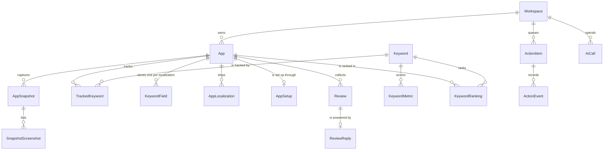

An app is one row with a home storefront. Keywords are separate rows scoped by text, store and country, and a join table connects the two. That shape is what lets a single app track keywords in many markets without duplicating the app.

## Entities

| Entity | Purpose | Key rule |
| --- | --- | --- |
| `Workspace` | The tenant boundary | One seeded default workspace in v1 |
| `User` | An account with a role and a plan | Email is unique. The first account bootstraps as owner |
| `ApiToken` | A revocable personal API token | Stored as a SHA-256 hash, never as plaintext |
| `AppGroup` | A linked group of listings across stores | Unique on group and store, so a group holds one app per store |
| `App` | One tracked listing, with the reply guidelines its AI drafts follow in `replyGuidelines` | Unique on workspace, store, store app id and country |
| `AppSnapshot` | A captured copy of the listing metadata | Keeps the raw payload for reprocessing. One stream per market: a snapshot with no market is the home listing |
| `Keyword` | A phrase in one store and one storefront | Unique on `text`, `store`, `country` |
| `TrackedKeyword` | The link between an app and a keyword | Keyed on app and keyword, carries `source` and `relevance` |
| `KeywordField` | The iOS keyword field of one App Store localization | Keyed on app and localization. Holds the normalized phrases in the order they were saved, and is private to the owner |
| `AppLocalization` | One App Store localization the app ships beyond the default one of its home storefront | Keyed on app and localization. Origin is `manual` or `detected`. Deleted with its app |
| `AppSetup` | The guided setup of one tracked app: status, skipped steps, countries reviewed, selected markets | Keyed on app. Started by the import and kept on the account, so every member and every device sees the same progress. Deleted with its app |
| `KeywordMetric` | Persisted popularity and difficulty for a day | Keyed on keyword and date |
| `KeywordRanking` | One position observation | Keyed on app, keyword and date. Carries `depth` |
| `SerpEntry` | One search result row for a keyword and day | Keyed on keyword, date and position |
| `CategoryRank` | A free, paid or grossing chart position | Keyed on app, date, collection and genre |
| `ChartCapture` | One day of one top chart, captured once for every workspace | Shared store data with no workspace. Unique on store, country, collection, genre, device and date. Carries `depth`, the number of positions the store answered |
| `ChartEntry` | One row of a top chart capture: a position and the app's title, developer, icon, genre and price class as that storefront showed them that day | Shared store data. Keyed on capture and position, deleted with its capture |
| `ChartFollow` | One chart kind of a category a workspace wants captured every day; the plan's follow limit counts the categories the rows belong to | Tenant owned. Unique on workspace and chart key |
| `Review` | A synced store review, with the text of the developer reply Google Play shows in `replyText` and the translation kept for one language | Unique on app and store review id |
| `ReviewReply` | The reply kept for one review: its text, how it was made and the owner's replied mark | Keyed on review. Tenant owned, deleted with its review and its app |
| `ChangeEvent` | A detected metadata change | Covers owned and competitor apps, in the home market or any other market you track |
| `AuditScore` | A daily audit score snapshot | Keyed on app and date |
| `ActionItem` | One Action Center recommendation | Unique on workspace and fingerprint |
| `ActionEvent` | One lifecycle transition of an action | Tenant owned, pruned with its action |
| `AiCall` | One AI call a workspace made, with its model and tokens | Tenant owned, counted against the monthly AI allowance, kept when its app is deleted |
| `SnapshotScreenshot` | One screenshot of one snapshot: its position, address and the caption read from it | Tenant owned, deleted with its snapshot |
| `ScreenshotText` | The text read from one public image under one reading recipe | Shared across workspaces like `Keyword`, no policy, pruned when unused for 90 days |
| `Webhook`, `EmailAlert` | Alert subscriptions | Deliveries are logged per channel |

## How do they relate?

A workspace owns apps. Each app captures snapshots of its listing and tracks keywords through a join table, because the same keyword row is shared by every app that tracks it. Popularity and difficulty attach to the keyword, while a position attaches to the pair of an app and a keyword on a given date. Action items belong to the workspace, and each one records its lifecycle as events: one row per transition, such as opened, done or confirmed fixed, deleted together with the action.

## Rules that are easy to get wrong

- **An app is one row.** Countries live on keyword tracking, not on a second app row. See [Countries and markets](/concepts/countries).
- **`Keyword` is unique on `text`, `store` and `country`.** The same phrase tracked in two markets is two keyword rows checked by two searches.
- **A competitor is an app row too.** It carries `isCompetitor` and points at the primary app it was added to.
- **Popularity and difficulty persist in `KeywordMetric`. Opportunity does not persist.** It is computed in the read layer from the stored popularity and difficulty. See [Popularity, difficulty and opportunity](/concepts/scoring).
- **`installs` is a `BigInt`** and serializes as a JSON number.
- **All dates are UTC.** Daily granularity uses a PostgreSQL `date` column, and today means the UTC date.
- **Every tenant owned row carries `workspaceId`, and PostgreSQL enforces it.** Each of those tables has a `tenant_isolation` row level security policy, so a query with no workspace in scope returns nothing rather than everything. Service code does not filter by workspace in a `where` clause. `Keyword`, `KeywordMetric` and `SerpEntry` are deliberately global and carry no policy, because one search for a phrase serves every workspace tracking it. `ScreenshotText` is global for the same reason: a screenshot is public store data, so one read serves every workspace that tracks the app. What is tenant owned is the tracking relation and the recorded position.

## How does the schema change?

Only forward. Every schema change ships as a forward Prisma migration and the API applies pending migrations on boot. There are no hand written SQL migrations and no down migrations, which is why a rollback is a database restore. See [Upgrade and roll back](/install/upgrade).
